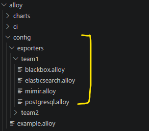
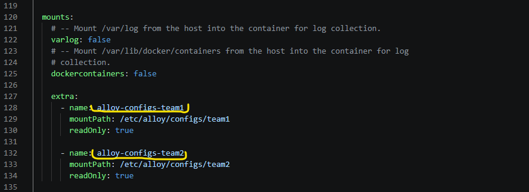
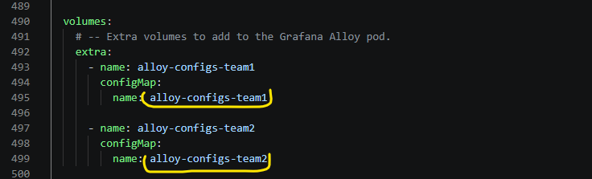
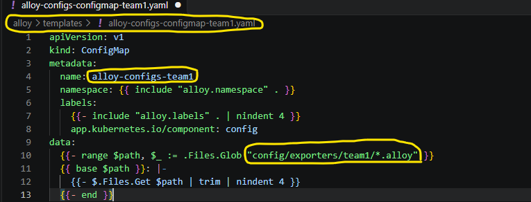
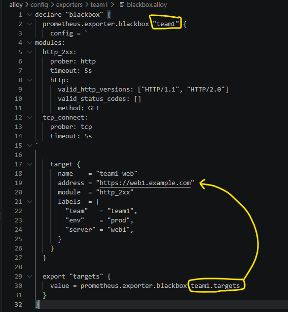
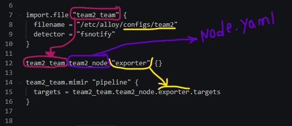

# Grafana Alloy Helm chart:

  

Helm chart for deploying [Grafana Alloy][] to Kubernetes.

[Grafana Alloy]: https://grafana.com/docs/alloy/latest/

## Install
```
helm install alloy alloy/ --version 1.11.1
```

## Define New Team
1. Our structure like: 
      - Each team has own directory
        
2. Change the helm values:
      - Define new **volumemount** and **configmap**
        
        
      - Create new configmap under Templates directory
        
3. Defining new team must follow some steps:
      - Define Exporter You Need:
        
      - Define Pipeline That Route Our Targets To **Mimir** And Some Filter(Optional):
        

4.  Defining **alert** for specific team checks [alert](../team-alerts/):

> [!warning]
> Reloading configuration by **curl -X POST http://<alloy-address>:12345/-/reload**
## Contact
Hassan Yousefi - [hsn.yousefi158@@gmail.com]

## license
Apache License 2.0