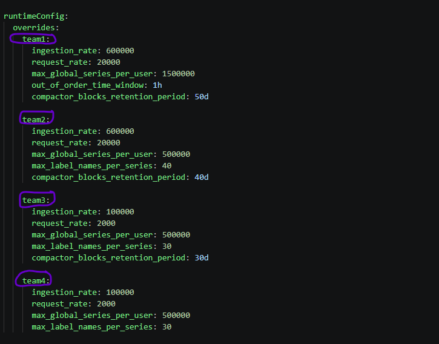

# mimir

## Installation
1. Requirment:
      - kubectl create ns mimir
      - wget https://github.com/grafana/helm-charts/releases/download/mimir-distributed-6.0.3/mimir-distributed-6.0.3.tgz
      - helm -n mimir install mimir grafana/mimir-distributed -f -f mimir/mimir-distributed/values.yaml

2. Upgrade
      - helm upgrade mimir mimir/mimir-distributed -n mimir -f mimir/mimir-distributed/values.yaml

3. Uninstall
      - helm -n mimir uninstall mimir grafana/mimir-distributed
4. Health tenant
      - curl -s -H "X-Scope-OrgID: tenant-name"   "http://mimir.example.com/prometheus/api/v1/labels" | jq

5. Route 
      - handling route for mimir needs to define gateway and httproute, that route PATH to the specific services
      - kubectl apply -f mimir/http-route.yaml
      - kubectl apply -f mimir/gateway.yaml

## Alerting
1. Defining **alert** for specific team checks [alert](../team-alerts/):  
## Adding new team
- Each team has own directory

## Contact
Hassan Yousefi - [hsn.yousefi158@@gmail.com]

## License
For open source projects, say how it is licensed.